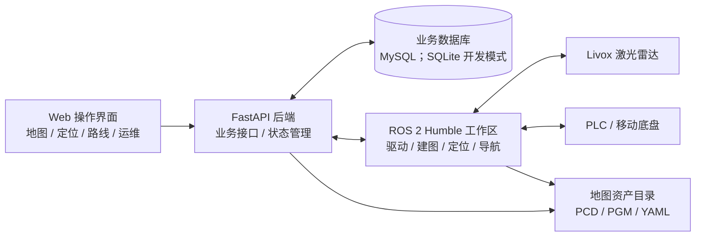

# Orange Robotics

**基于 ROS 2 Humble 的移动机器人建图、定位、导航与 Web 运维平台**

面向 Ubuntu 22.04 工控机和 AGV/AMR 场景的工程实践项目。通过 **ROS 2 工作区 + Python FastAPI 后端 + Web 操作界面**，把雷达配置、点云建图、地图管理、定位初始化、路线编辑和运行维护组织到同一套系统中。

> **当前阶段：持续开发与分层验证。** 仓库包含可运行的软件模块、自动化测试和仿真验收流程，但不代表已完成真实雷达、PLC、底盘运动及整车安全验收。硬件相关能力必须在目标设备上单独验证。

## 主要能力与验证状态

| 模块 | 当前实现与工程要点 | 验证边界 |
| --- | --- | --- |
| **雷达发现与配置** | 基于 Livox 发现协议解析设备响应，区分 MID-360 / MID-360S；支持在 Web 中管理雷达配置、安装外参与运行参数 | 已有协议解析和配置相关测试；发现设备不等于修改设备自身 IP，实物型号、网卡、点云和 TF 仍需现场核对 |
| **SLAM 建图与地图资产** | 集成 LIO-SAM、点云保存、PCD 地图处理与二维 PGM/YAML 资源管理；Web 与 ROS 共用地图目录 | 有接口、流程和仿真验证；真实场地建图质量及完整保存链路需现场验收 |
| **定位与重定位** | 集成激光定位链路；包含初始位姿交互、地图切换、定位恢复及候选搜索机制 | 自动重定位的逻辑与部分数值测试已完成；真实场景成功率、误匹配拒绝和时序需验证 |
| **路线与任务工作台** | 地图点位/路径编辑、草稿保存、发布版本、地图资源隔离、任务配置和状态反馈 | 已开展本地及接口回归测试；实际导航轨迹与速度控制需实车验证 |
| **ROS 2 与工业通信** | 管理雷达、定位、导航及 PLC 相关 ROS 服务；检查话题、坐标变换、运行状态及通信反馈 | 目标 PLC 寄存器协议、停车反馈、物理使能和安全回路必须经现场确认 |
| **部署与运维** | Linux systemd 服务、运行配置模板、检查脚本、源码交付包与部署文档 | 交付包**仍需要**在目标 Ubuntu/ROS 2 环境构建 ROS 工作区；此项目不宣称免编译部署 |

## 技术架构



**技术栈**

- **机器人系统：** Ubuntu 22.04、ROS 2 Humble、Launch、TF、Topic、Nav2、LIO-SAM、NDT 定位
- **传感器与通信：** Livox MID-360 / MID-360S、点云处理、TCP/IP、PLC / Modbus 通信适配
- **后端与数据：** Python、FastAPI、数据库模型与迁移、MySQL（生产部署方案）、SQLite（本地开发）
- **前端与运维：** HTML / CSS / JavaScript、WebSocket、Bash、systemd、自动化测试

## 工程实现重点

1. **设备配置自动化：** 通过 Livox 搜索报文及响应校验发现设备，识别型号与地址信息，辅助现场填写配置；明确区分“发现/回填配置”与“修改设备 IP”。
2. **跨模块数据链路：** 连接点云采集、建图保存、PCD/PGM 地图资产、地图路径管理、定位初始化和导航工作台，降低模块间配置不一致的风险。
3. **配置与启动管理：** Web、ROS 和 systemd 服务使用明确的运行目录与配置项；拆分雷达核心、建图、定位和导航的启动依赖。
4. **问题定位与验证：** 通过 ROS 状态、地图身份、数据新鲜度、服务日志和后端测试定位通信、地图和定位链路问题；将仿真通过与实车通过分开记录。
5. **运动安全边界：** 未确认 PLC 协议、停车反馈、外参和硬件保护前，不应开启实际运动控制。软件停止锁、点云防护不替代硬件急停。

## 仓库结构

```text
.
├── backend/                FastAPI、业务服务、数据库与自动化测试
├── frontend/               Web 页面、地图工作台与交互资源
├── ros/orange_nav_ws/      ROS 2 驱动、建图、定位、导航和底盘通信工作区
├── ops/                    运行配置、systemd、检查脚本与交付打包
├── docs/                   部署、地图、ROS、接口与验收说明
├── runtime_data/           本地运行目录占位；实际数据不随源码发布
└── SOURCE_MANIFEST.txt     ROS 源码与依赖清单
```

历史 Java 工程和旧地图样例不属于本仓库当前运行链，亦不包含在新系统交付包中。

## 快速开始

**本地/仿真验收（不控制真实机器人）**

按 [本地验收步骤](docs/MONDAY_ACCEPTANCE.md) 准备独立测试数据目录、Python 环境与仿真模式，先检查健康接口，再按“地图创建 → 路线编辑 → 草稿保存 → 版本发布 → 任务配置”验证基础链路。

**Ubuntu 22.04 + ROS 2 Humble 部署**

查看 [独立系统部署说明](docs/PYTHON_FRESH_SYSTEM.md)。首次安装从仿真模式和空数据目录开始，在验证实际雷达、TF、PLC 协议与停车反馈后，再逐项启用 ROS 控制功能。

**生成源码交付包**

```bash
python3 ops/packaging/build_fresh_bundle.py --list
python3 ops/packaging/build_fresh_bundle.py --output /tmp/orange-fresh-source.tar.gz
```

交付清单不包含本地地图、数据库、密钥或历史归档；ROS 依赖仍需在目标 Linux 机器检查和编译。

## 地图数据约定

Web 与 ROS 使用同一份运行配置，其中：

| 资产 | 约定位置 |
| --- | --- |
| 三维点云地图 | `$ROBOT_PCD_DIR/<地图编号>/GlobalMap.pcd` |
| 建图辅助文件 | `$ROBOT_PCD_DIR/<地图编号>/` 下的其他点云与轨迹文件 |
| 二维栅格地图 | `$ROBOT_MAP_DIR/<地图编号>/setting/map.pgm` |
| 地图元数据 | `$ROBOT_MAP_DIR/<地图编号>/setting/map.yaml` |

本地开发可使用 `runtime_data/`，目标环境示例使用 `/var/lib/orange/`。**不要将现场地图、账号、密钥或设备专有参数直接提交到公开仓库。**

## 验证范围与待办

- [x] 雷达发现协议解析及异常数据校验测试
- [x] 地图、定位、任务和 Web 操作相关的本地/接口回归测试
- [x] 源码打包、运行配置模板及部署说明
- [ ] 目标 Ubuntu 工控机上完整 ROS 构建与运行验收
- [ ] MID-360 / MID-360S 实物数据、外参、TF 与地图链路验收
- [ ] PLC 协议、停车反馈、低速路线和异常停车的整车验收
- [ ] 多车路权、真实 WMS/OTA 与长期稳定性验证

详细功能缺口参见 [FEATURE_GAPS](docs/FEATURE_GAPS.md)，定位与运动的真实验收要求参见 [AUTO_LOCALIZATION_MOTION_CHECK](docs/AUTO_LOCALIZATION_MOTION_CHECK.md)，ROS 系统边界参见 [ROS_RUNTIME_DELIVERY](docs/ROS_RUNTIME_DELIVERY.md)。

## 代码与使用说明

本项目用于技术学习、工程集成与原型验证，**不应直接用于未经现场验收的机器人自主运行**。引用的第三方驱动与算法须遵守各自许可证；若包含雇主或第三方的非公开源码、商标、内部地址或配置，应先核对授权并移除，确认可公开后再对外展示。

---

**求职项目概述：** 基于 ROS 2 Humble、FastAPI 与 Web 工作台开展移动机器人建图定位导航系统集成，涉及 Livox 雷达自动发现、LIO-SAM/NDT 工程应用、PCD/PGM 地图管理、导航流程联调及 Linux 部署维护。项目展示软件架构和工程实践，不将仿真结果表述为实车交付成果。
